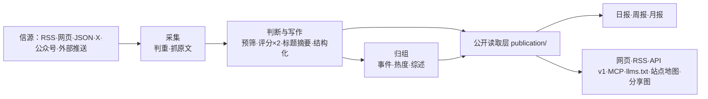

# 架构导读

这份文档是给"想快速搞明白这个站在怎么跑"的人看的：进程、框架、目录、数据流，一页读完。
**权威版本仍然是 [架构](architecture.md)**（里面是必须守住的约定，`tests/architecture.test.ts` 会检查）；
这里只做汇总和导读，两者不一致时以 `architecture.md` 和代码为准。

## 一句话

Node.js 24 单体仓库（npm workspaces），三个进程（api / worker / web）+ PostgreSQL，用 Docker Compose 组成一个站点。
**后端没有构建步骤**，直接执行 TypeScript；只有前端（web）需要构建。

## 拓扑

```
                    ┌──────── Caddy（可选，--profile https，80/443）────────┐
                    │                                                      │
读者 / Agent ──────▶ web :3000 ──(/api/* 反向代理)──▶ api :3001 ──▶ PostgreSQL 17
                    │  React Router SSR                    Fastify          ▲
                    │  不碰数据库                            ▲              │
                    └────────────────────────────────────────┼──────────────┘
                                                    worker ──┘
                                              pg-boss 队列 + 定时任务
                                          采集 / 模型 / 归组 / 日报 / 告警
```

| 进程 | 位置 | 做什么 | 端口 |
|---|---|---|---|
| api | `apps/api/` | Fastify：网站自用接口（`/api/site/`）、公开 API（`/api/v1/`）、RSS、MCP（`/api/mcp`）、后台接口（`/api/admin/`）、图片代理、分享图 | 3001 |
| worker | `apps/worker/` | pg-boss 任务队列和定时任务：抓信源、调模型、归组、热度、日报、告警、清理、备份 | — |
| web | `apps/web/` | React Router 服务端渲染的网页（公开页面 + `/admin`），只通过 HTTP 读 api | 3000 |

生产环境 `web` 会把 `/api/*` 代理给 `api`，所以**对外只有一个端口**（默认 3000）。
Docker Compose 起 `db`、`setup`（跑迁移和种子后退出）、`api`、`worker`、`web` 五个容器，HTTPS 再加 `caddy`。

## 技术栈

### 前端（`apps/web`）

| 用途 | 选型 |
|---|---|
| 框架 | React 19.3 + **React Router 8.4**（framework 模式，服务端渲染；不是 Next.js，也不是纯 SPA） |
| 构建 | Vite 8.3（`react-router dev` / `build`） |
| 样式 | Tailwind CSS 4.3 + `@tailwindcss/vite` |
| 动效 | `motion` 13 |
| 代码高亮 | `highlight.js` |
| 数据获取 | 路由 `loader`（SSR 时打 api 的 HTTP 接口）+ 少量客户端 fetcher；没有全局状态库、没有 react-query |
| 生产服务器 | 自写的 `apps/web/server.ts`：静态资源、重定向表、SSR、API 代理、缓存头 |

每个页面在 `apps/web/app/routes/` 一个文件，路由表在 `app/routes.ts`；只属于某页的代码随那一页加载。

### 后端（`apps/api`、`apps/worker`、`packages/backend`）

| 用途 | 选型 |
|---|---|
| 语言/运行时 | Node.js 24（≥24.11）**直接执行 TypeScript**，无编译、无产物 |
| HTTP 框架 | Fastify 5.12 |
| 参数校验 | zod 4 |
| MCP | `@modelcontextprotocol/server` 2.1 |
| 任务队列 | **pg-boss 12**（队列就在 PostgreSQL 里，没有 Redis、没有 Kafka） |
| 数据库访问 | postgres.js（`postgres` 3.4）——**裸 SQL，没有 ORM** |
| 数据库结构 | 手写迁移 `database/migrations/*.sql`（按完整文件名排序执行和记账） |
| HTTP 客户端 | undici |
| 解析 | `fast-xml-parser`（RSS/Atom）、`cheerio`（网页列表） |
| 正文提取与清洗 | `@mozilla/readability` + `linkedom`、`sanitize-html` |
| HTML ↔ Markdown | `turndown`、`marked`（供 Agent Markdown / llms.txt） |
| 分享图 / 二维码 | `satori` + `sharp` + `uqr` |
| ID | `@paralleldrive/cuid2` |

### 数据与基础设施

PostgreSQL 17 · pg-boss 队列 · Docker 多阶段构建（**一个镜像四个角色**）· Caddy 自动 HTTPS ·
S3 兼容对象存储（每日备份）· 测试用 Node 内置 `node:test` + Playwright（仅 web 页面测试）。

## 代码结构

```
apps/api/          Fastify 接口（只做 HTTP，业务逻辑都在 packages/backend）
apps/worker/       队列消费者 + 定时任务（schedules.ts）
apps/web/          React Router 应用（公开页面 + /admin）
packages/backend/  全部业务逻辑
  sources/    六种信源读取器（rss / web_list / json_list / x_search / mp_account / external）
  content/    资料入库、判重、正文提取和清洗
  editorial/  判断与写作（analyze.ts、prompts.ts、models.ts）
  events/     事件归组、热度、事件综述
  publication/  唯一的公开读取层 ★
  reports/    日报 / 周报 / 月报
  providers/  llm / embeddings / socialdata(X) / dajiala(公众号) / jina，含 receipts.ts 回执与预算
  admin/      后台接口
  notify/ operations/ jobs/ site/ media/ ingest/ lib/
packages/contracts/  前后端共享类型（admin.ts、mcp.ts、modules.ts、http-policy.ts、time.ts…）
industry/   行业包：taxonomy.ts、topics.json、sources.json、prompts/、selection.ts
site/       站点包：site.ts、models.ts、brand/、pages/、public/、modules/
modules/    只有某个站要的功能（框架自带 0 个）
database/migrations/  迁移文件
scripts/    初始化 / 迁移 / 种子 / 评测 / 检查
tests/      后端测试（数据库名必须以 _test 或 _ci 结尾）
```

关键分界：**站点的东西在 `site/`，行业的东西在 `industry/`**，代码里不写死某个站的值。
换一个行业通常不动 `apps/` 和 `packages/`。

## 一次内容的数据流



一条资料的走向：信源 → 判重 → 预筛 → 可能的资料独立打两次分并写中文标题摘要 →
和相近报道归成事件、算热度 → 过了门槛且不是精选里已有新闻的重复才进精选 →
日报按规则编排（不调模型），周报月报从日报汇编。

## 六种信源

`rss`、`web_list`（网页列表）、`json_list`（JSON 接口）、`x_search`（X 账号）、`mp_account`（微信公众号）、
`external`（自己脚本推送进来的内容，接口 `/api/ingest/items`）。
信源分三级（官方一手 / 官方账号与准官方 / 媒体与个人），各级入选门槛不同，抓取频率按产出自动调整。

## 定时任务（都在 worker，时区 Asia/Shanghai）

| 任务 | 频率 | 做什么 |
|---|---|---|
| `sources.schedule` | 每分钟 | 到点的信源入队抓取（`COLLECT_ENABLED=true` 才注册） |
| `content.sweep` | 每 5 分钟 | 处理还没走完流程的资料 |
| `content.translate` | 每 5 分钟 | 已入选条目的全文翻译（付费调用） |
| `hot.rank` / `hot.snapshot` | 每 5 分钟 / 每小时 | 事件热度排名、热度快照 |
| `stories.links` | 每小时 | 事件之间的关联 |
| `reports.compose` | 每半小时 | 到期的日报/周报/月报 |
| `ops.recover` / `ops.alerts` | 每 10 分钟 | 清理半途中断的任务、核对告警 |
| `ops.retention` / `ops.backup` | 每天 03:30 / 04:10 | 隐私期限内的删除、数据库备份 |
| `sources.adapt-intervals` / `sources.icons` | 每天 04:20 / 04:40 | 调整抓取频率、刷新信源图标 |

出刊时间在 `site/site.ts` 的 `EDITION_TIMES`（默认日报 08:00、周报周一 10:00、月报每月 1 日 10:30），
排程只是每半小时检查"该出的出了没有"。

## 要守住的硬约束

1. **web 只能通过 HTTP 读 api**：数据库、模型调用、密钥只在后端。
2. **页面不调模型**：模型只在 worker 的任务里调用；读者刷页面不花钱。
3. **一个公开读取层**：网页、RSS、API、MCP、站点地图、分享图都读 `packages/backend/src/publication/`；
   公开范围、精选席位和撤回规则只在 `publication/scope.ts` 定义。
4. **付费请求有回执**：模型、X、公众号、Jina 每个请求先记一张回执，结果先存再用；
   重启和重试复用已付过钱的结果（`providers/receipts.ts`）；结果不明的回执 30 分钟后自动放行一次。
5. **预算熔断**：每个付费服务有每分钟/小时/天上限，超过就暂停（后台"设置 → 付费请求上限"）。
6. **安全阀只有写成小写 `true` 才打开**：`COLLECT_ENABLED`、`MODEL_CALLS_ENABLED`、
   `FEISHU_CONTENT_PUSH_ENABLED`、`FEISHU_INTERNAL_ENABLED`、`INDEXNOW_SUBMIT_ENABLED`；
   没写就是关。测试里推送一直关着，采集和模型调用只连本地假服务。
7. **公开内容匿名**：管理员和访客看到的一样；收藏和阅读设置只存在浏览器里；后台只允许管理员。
8. **旧文不刷屏**：发现时已发布超过 48 小时的资料按原文时间归档，不进"今天"、不推送；
   新信源第一次导入之后不再收列表里更早的存量。
9. **跨进程接口共享类型**：后台接口以 `packages/contracts/src/admin.ts` 为准，
   任务载荷以 `jobs/queue.ts` 的 `JobData` 为准，收发两边一起检查。

## 对外出口

| 地址 | 内容 |
|---|---|
| `/` `/all` `/hot` `/topics` `/daily` `/weekly` `/monthly` | 精选、全部动态、热门事件、主题、日报周报月报 |
| `/feed.xml` `/feed/full.xml` `/feed/all.xml` `/feed/daily.xml` `/feed/weekly.xml` `/feed/monthly.xml` | RSS；另有 `/feed/category/<key>.xml` 和分类全文版 `/feed/full/category/<key>.xml` |
| `/api/v1/` | 公开 API，文档 `/openapi-v1.json`；Agent Markdown 从 `/api/v1/agent` 开始，说明页 `/agent` |
| `/api/mcp` | MCP 服务（最新、搜索、热点、事件、日报、周报、月报各一个工具，前缀取自 `site/site.ts`） |
| `/llms.txt` `/sitemap.xml` `/robots.txt` | 给大模型和搜索引擎的说明 |
| `/admin` | 后台 |

后台（`apps/web/app/routes/admin/`）：信源管理与试抓、内容诊断与人工评分更正、精选评测（SelectBench）、
每步单独换模型、付费请求上限、运行记录与告警、审计日志、反馈处理。数据全部来自 `/api/admin/*`。

## 本机启动速查

用 Docker（推荐，一条命令）：

```bash
node scripts/init-env.ts --llm-key <你的模型 API Key>
docker compose up -d --build
```

不用 Docker 的本地开发（三个进程、三个终端）：

```bash
npm ci
node scripts/init-env.ts --llm-key <你的模型 API Key>
createdb myhot                                   # 再在 .env 里补 DATABASE_URL、API_BASE_URL
node --env-file=.env scripts/migrate.ts
node --env-file=.env scripts/seed.ts
npm run dev:api      # 3001
npm run dev:worker
npm run dev:web      # 3000
```

只看页面、库里已经有内容时，`dev:worker` 可以不开（它管采集、模型和定时任务）。

改完代码至少跑：

```bash
npm run typecheck
DATABASE_URL=postgres://127.0.0.1:5432/<名字>_test npm test
npm run build -w @aihot/web && node --test apps/web/tests/*.test.ts
node scripts/smoke.ts --base http://localhost:3000   # 站点跑起来以后
```
